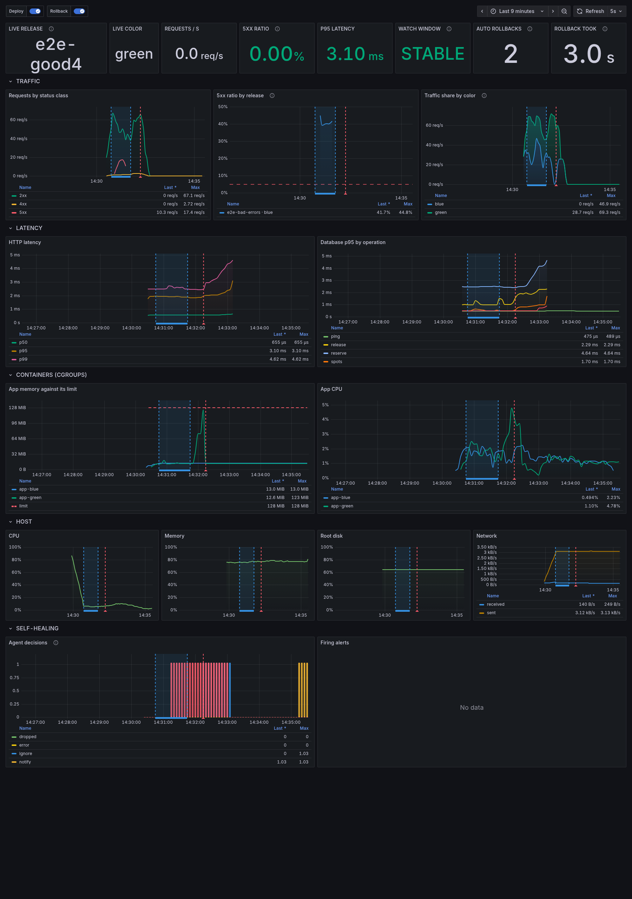
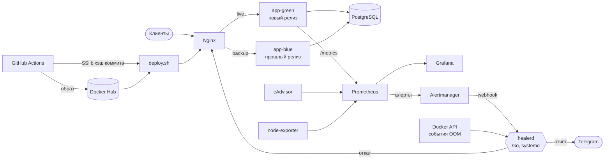

# Resilience-Stack

GitOps-инфраструктура с самовосстановлением для бэкенда умной парковки. Если в `main` попадает релиз, который сыплет 5xx или течёт по памяти, система сама замечает это, возвращает трафик на предыдущую версию и присылает отчёт в Telegram:

```text
✅ Деплой 8f3a2b1 отменен: обнаружена утечка памяти. Выполнен откат на версию 7c1d9e0. Uptime сохранен.
Откат занял 3.1 с.
```



## Архитектура



| Часть | Где лежит | Что делает |
|---|---|---|
| Бэкенд `parkd` | [app/](app/) | Домен парковки на Go, перенесён с Java-версии: тарифы, места, бронирование, чек |
| Агент `healerd` | [agent/](agent/) | Systemd-демон на Go без внешних зависимостей |
| Деплой | [deploy/scripts/deploy.sh](deploy/scripts/deploy.sh) | Blue-green с поэтапным переводом трафика 10% → 50% → 100% |
| Мониторинг | [deploy/](deploy/) | Prometheus, Alertmanager, Grafana, cAdvisor, node-exporter |
| IaC | [ansible/](ansible/) | Настройка чистого сервера одной командой |
| CI/CD | [.github/workflows/cicd.yml](.github/workflows/cicd.yml) | Тесты, сборка, публикация образа, деплой |

## Как работает самовосстановление

1. `deploy.sh` поднимает новую версию рядом со старой и ждёт healthcheck. Если контейнер не стал здоровым, живой трафик не меняется.
2. Трафик переходит на новую версию ступенями. Старая остаётся в nginx как `backup` на всё окно наблюдения.
3. В течение двух минут после деплоя агент реагирует на три сигнала:

   | Сигнал | Источник | Условие |
   |---|---|---|
   | `high_error_rate` | Alertmanager | Больше 5% ответов 5xx в течение 10 секунд при трафике от 0.5 запроса в секунду |
   | `memory_leak` | Alertmanager | Контейнер занял больше 85% лимита памяти |
   | `oom_killed` | Docker events | Ядро убило контейнер из-за нехватки памяти |

4. Откат: агент переключает nginx на прошлую версию, проверяет снаружи заголовок `X-App-Version`, останавливает плохой контейнер и помещает релиз в карантин. Повторно задеплоить его можно только с `FORCE=1`.
5. Если за две минуты проблем не было, агент сам останавливает старую версию.

Сбой после окна наблюдения не откатывается автоматически: агент только присылает предупреждение, потому что причина уже может быть не в деплое.

## Быстрый старт на своей машине

Нужны Docker с Compose, Go 1.27+, `jq`, `curl` и `make`.

```bash
make up                  # стек и агент
make release V=v1        # первый релиз
make release V=v2        # второй релиз, теперь есть куда откатываться
make load                # трафик, запускать в отдельном терминале
```

Сломанные релизы для демонстрации:

```bash
make release-bad-errors V=bad1   # 40% запросов падают с 500
make release V=v3                # новая стабильная версия для следующего отката
make release-bad-leak V=bad2     # утечка памяти до OOMKilled
make status                      # текущий релиз и журнал откатов
```

| Сервис | Адрес |
|---|---|
| API | http://127.0.0.1:8088/api/v1/spots?free=true |
| Grafana | http://127.0.0.1:3000, логин `admin`, пароль в `deploy/.env` |
| Prometheus | http://127.0.0.1:9090 |
| Alertmanager | http://127.0.0.1:9093 |

Остановить всё: `make down`. Удалить ещё и данные: `make clean`.

## Тесты

```bash
make test   # юнит-тесты с race detector
make e2e    # 8 сквозных сценариев на настоящем стеке, около 6 минут
```

Сквозные сценарии проверяют деплой без простоя под нагрузкой, откат при 5xx, откат при утечке памяти, карантин, релиз, который не стал здоровым, вывод резерва из работы и защиту вебхука. Вместо Telegram в них работает локальная заглушка.

## Развёртывание на сервере

Плейбук проверен на Debian 12. Он рассчитан и на Ubuntu 22.04+, но там ещё не запускался.

**1. Настройте Ansible** (нужны `ansible-core` и Go на вашей машине):

```bash
cd ansible
ansible-galaxy collection install -r requirements.yml
cp inventory.example.ini inventory.ini
cp group_vars/all/vault.example.yml group_vars/all/vault.yml
ansible-vault encrypt group_vars/all/vault.yml
```

Впишите адрес сервера в `inventory.ini`, секреты в `vault.yml`, а в `group_vars/all/main.yml` укажите `app_image_repo` и `ci_deploy_public_key`.

**2. Запустите настройку сервера:**

```bash
ansible-playbook site.yml --ask-vault-pass
```

Плейбук обновит ядро и перезагрузит сервер при необходимости, поставит Docker, настроит ufw, создаст пользователей, поднимет мониторинг и запустит `healerd`.

**3. Заполните настройки репозитория на GitHub:**

| Тип | Имя | Значение |
|---|---|---|
| Variable | `DOCKERHUB_REPO` | Например, `yourname/parkd` |
| Secret | `DOCKERHUB_USERNAME` | Логин Docker Hub |
| Secret | `DOCKERHUB_TOKEN` | Токен доступа Docker Hub |
| Secret | `DEPLOY_HOST` | Адрес сервера |
| Secret | `DEPLOY_SSH_KEY` | Приватная часть ключа `ci_deploy_public_key` |
| Secret | `DEPLOY_KNOWN_HOSTS` | Вывод `ssh-keyscan <адрес сервера>` |

После этого каждый пуш в `main` проходит весь конвейер. SSH-ключ CI ограничен принудительной командой: он может только задеплоить коммит по хэшу.

Grafana и Prometheus слушают только `127.0.0.1`, поэтому открывайте их через туннель:

```bash
ssh -L 3000:127.0.0.1:3000 -L 9090:127.0.0.1:9090 root@<адрес сервера>
```

## Ограничения

- **Клиенты видят ошибки плохого релиза до отката.** Сигнал о 5xx появляется примерно через 20–30 секунд, поэтому часть запросов успевает получить 500. Поэтапный перевод трафика уменьшает их число, но не убирает полностью. «Uptime сохранен» означает, что сервис оставался доступен.
- **Миграции БД должны быть обратно совместимы.** Откат возвращает код, но не схему, поэтому старая версия должна работать с новой схемой.
- **Медленная утечка не откатывается автоматически**, если контейнер упал позже двух минут после деплоя. Окно задаётся через `healer_watch_window`.
- **Нет TLS.** Nginx принимает HTTP на порту 80, сертификаты нужно добавить под свой домен.
- **Один сервер.** Стек защищает от плохих релизов, но не от отказа самой машины.
